# HarmonyBlend (HB)

Fabrikanız/merkez ofisiniz ile bayi ağınız arasındaki sipariş, ödeme ve
cari hesap trafiğini tek bir yerden yönetmenizi sağlayan bir sistem.
Bugün bu süreç büyük ölçüde telefon, WhatsApp ve dağınık Excel
dosyalarıyla yürütülüyorsa — HarmonyBlend bunların hepsini tek bir
panelde, uçtan uca takip edilebilir hale getirir.

Birden fazla alt markanız (örn. Musluoğlu, Dilim Börek gibi) ve o
markalara bağlı bayileriniz varsa, HarmonyBlend tam bu yapı için
tasarlandı.

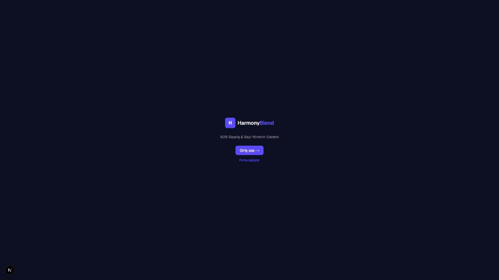

---

## Hangi Sorunu Çözüyor?

Çok markalı bir üretici/distribütörün bayi ağını büyüttükçe karşılaştığı
klasik sorunlar:

- Siparişler telefonla/WhatsApp'la geliyor, hangi bayinin ne sipariş
  ettiği, ne zaman onaylandığı tek bir yerde görünmüyor
- Her bayinin cari bakiyesi, kimin ne kadar borcu/alacağı olduğu elle
  takip ediliyor, hata payı yüksek
- Hangi markanın hangi bayiye, hangi fiyattan, hangi ödeme şekliyle
  sattığını tek bakışta görmek zor
- Büyüme ile birlikte bu dağınıklık katlanarak artıyor

HarmonyBlend, bu süreci bayinin kendi siparişini kendi panelinden
verdiği, sizin de tek bir yönetim panelinden her şeyi onayladığınız,
izlediğiniz ve raporladığınız merkezi bir sisteme dönüştürür.

---

## Nasıl Çalışıyor?

Bir siparişin HarmonyBlend'deki yolculuğu, baştan sona görünür ve
kayıtlıdır:

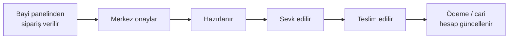

Her adım kayıt altında — bir siparişin ne zaman onaylandığını, kimin
onayladığını, hangi durumdan hangi duruma geçtiğini her zaman geriye
dönüp görebilirsiniz.

---

## Öne Çıkan Özellikler

**Marka & Bayi Yönetimi**
- Birden fazla alt markayı tek panelden tanımlayıp yönetirsiniz
- Her bayiyi istediğiniz markaya/markalara bağlarsınız — bayi panelinde
  sadece kendisine açık markaların kataloğunu görür, başka hiçbir şeye
  erişemez
- Her bayi için ayrı bir cari limit tanımlayabilirsiniz

**Sipariş & Ödeme**
- Bayi kendi panelinden ürün kataloğuna bakıp sepet oluşturur, siparişi
  tamamlar
- Üç farklı ödeme şekli: açık hesap (cari), kapıda ödeme, sanal POS —
  hangisinin hangi bayide açık olacağına siz karar verirsiniz
- Her siparişin durumu (onaylandı, hazırlanıyor, sevk edildi, teslim
  edildi...) her an görünür ve geçmişi kayıtlıdır

**Cari Hesap Takibi**
- Her bayinin güncel bakiyesi, borç/alacak hareketleri tek bir ekstrede
- Bayi, bir siparişe bağlı olmadan da cari borcunu kapatabilir
- Cari limit aşıldığında sistem otomatik olarak o bayi için açık hesap
  seçeneğini kapatır

**Görünürlük & Genel Bakış**
- Hem merkez hem bayi tarafında, o ay kaç sipariş geldiğini, cironun
  nasıl bir trend izlediğini, en çok sipariş edilen ürünleri gösteren
  bir özet ekran
- Sipariş geçmişi dışa aktarılabilir belgeler olarak indirilebilir

**Her Cihazdan Erişim**
- Masaüstü, tablet ve telefon ekranlarında aynı rahatlıkla kullanılır

---

## İki Panel, İki Deneyim

HarmonyBlend'in iki ayrı yüzü var: biri sizin (merkez/marka yönetimi),
biri bayilerinizin kullandığı panel. İkisi de aynı veriyi paylaşır,
ama her biri yalnızca kendi işine bakar.

### Yönetim Paneli

Siz ve ekibiniz — markaları, bayileri, ürünleri ve gelen siparişleri
buradan yönetirsiniz.

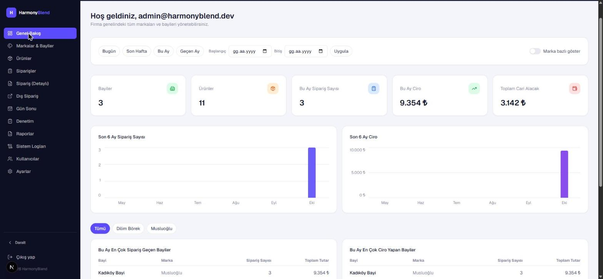

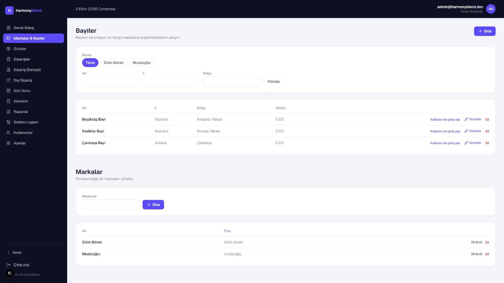

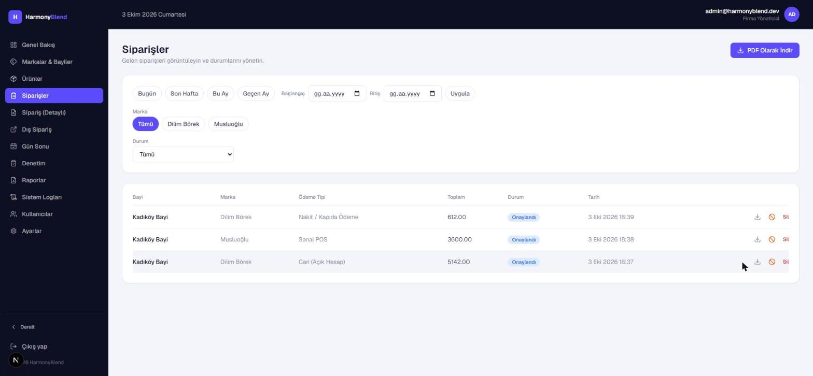

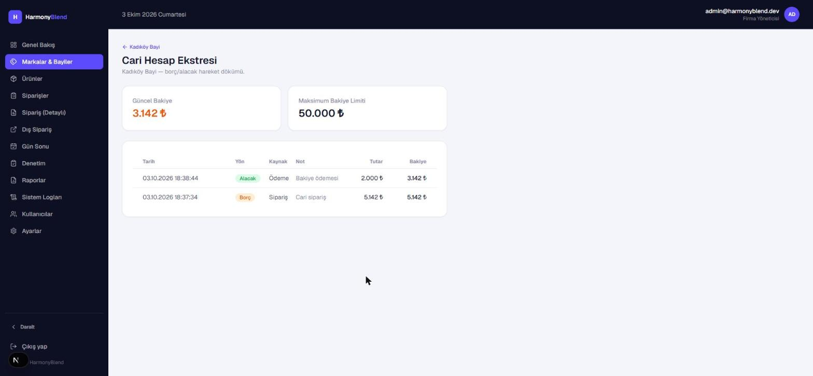

### Bayi Paneli

Bayileriniz kendi hesaplarıyla giriş yapar, sadece kendi markalarının
kataloğunu görür, sipariş verir, geçmiş siparişlerini ve cari bakiyesini
takip eder.

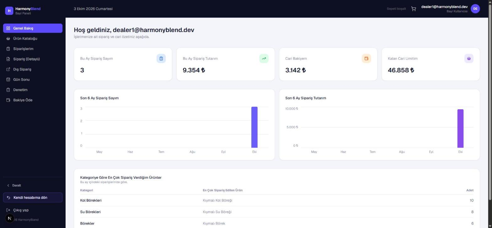

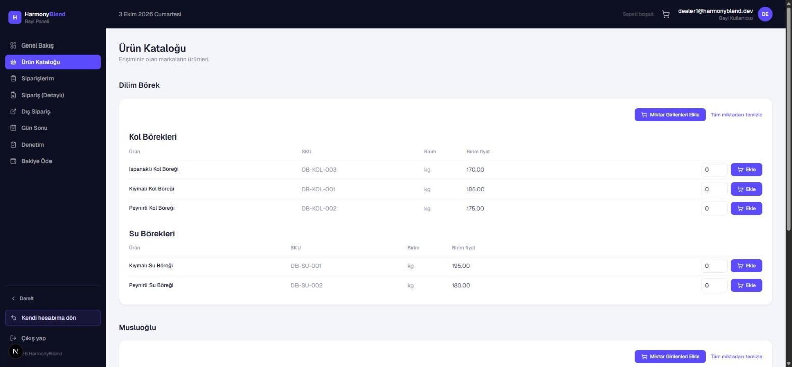

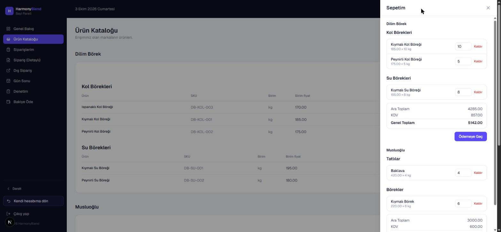

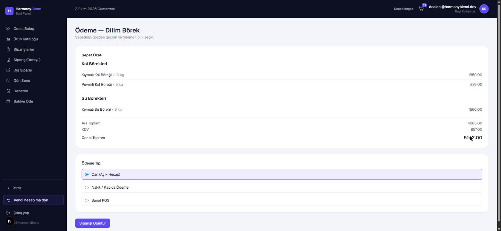

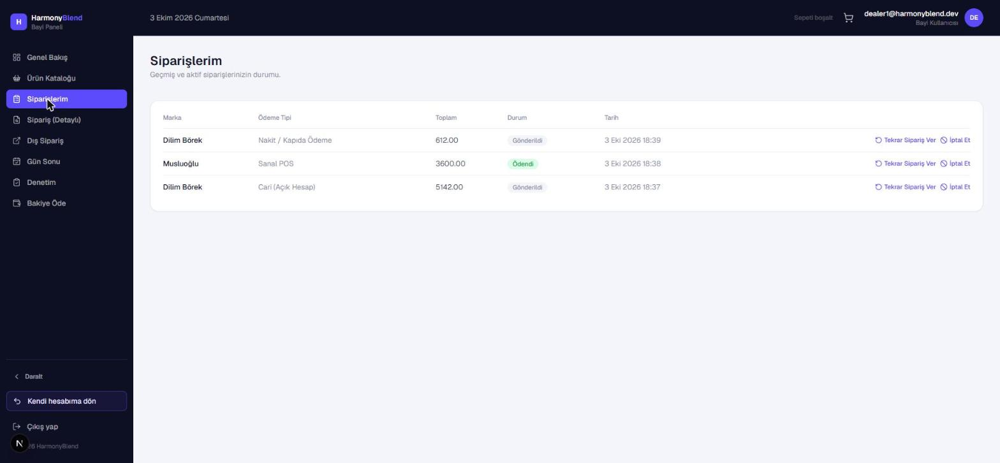

---

## Bugün Kullanılabilir Olanlar

Aşağıdakiler şu anda gerçek bir sistemde test edilmiş, kullanılabilir
özellikler — gelecek vaadi değil:

- Çok markalı katalog ve bayi/marka eşleştirmesi
- Bayi panelinden sepet oluşturma ve üç ödeme şekliyle sipariş tamamlama
- Sipariş durum takibi ve geçmişi
- Cari hesap bakiyesi, ekstre ve sipariş dışı bakiye ödemesi
- Merkez ve bayi tarafında aylık özet/trend ekranları
- Mobil ve tablet ekranlarında tam kullanılabilirlik
- Rol bazlı erişim (merkez yöneticisi / marka yöneticisi / bayi
  kullanıcısı)

## Yakında Gelecekler

Üzerinde çalışılan, ama henüz tamamlanmamış özellikler:

- Markaya özel sipariş saatleri/günleri — bir markanın hangi gün/saat
  aralığında sipariş alacağını siz belirleyebileceksiniz
- Bayi stok sayımı/mutabakatı için ayrı bir ekran
- Gün sonu özeti, ürün bazlı detaylı sipariş görünümü ve telefon/
  e-posta ile gelen siparişlerin elle girilmesi
- Bölgesel yetkilendirme ile daha fazla kullanıcı rolü (bölge müdürü,
  muhasebeci vb.)
- Talebe özel raporlar
- Gerçek bir banka/sanal POS entegrasyonu (şu an test modunda çalışıyor)

## Şu An Kapsam Dışı Olanlar

Dürüst olmak gerekirse, bugün şunlar sistemde yok:

- Gerçek bir bankadan canlı tahsilat — sanal POS adımı şu an test
  (mock) modunda, gerçek bir kartla para çekmiyor
- Muhasebe/ERP yazılımınızla otomatik entegrasyon
- Hazır, talep bazlı olmayan rapor şablonları

---

## Neden HarmonyBlend?

- **Dağınıklığın yerini merkezi bir sistem alır** — telefon/WhatsApp/
  Excel'in dağıttığı bilgi tek bir panelde toplanır
- **Markanız büyüdükçe sistem de büyür** — yeni bir marka veya bayi
  eklemek bir form doldurmaktan ibarettir
- **Her şey kayıtlı, geriye dönüp bakılabilir** — kim ne zaman ne
  yaptı, her sipariş ve ödeme için izlenebilir

---

**Bu sistemi kendi bayi ağınızda kullanmak ister misiniz?**
Bir demo için iletişime geçin.

EGMTRG Software and Development · Geliştirici: Egemen Turoğlu
