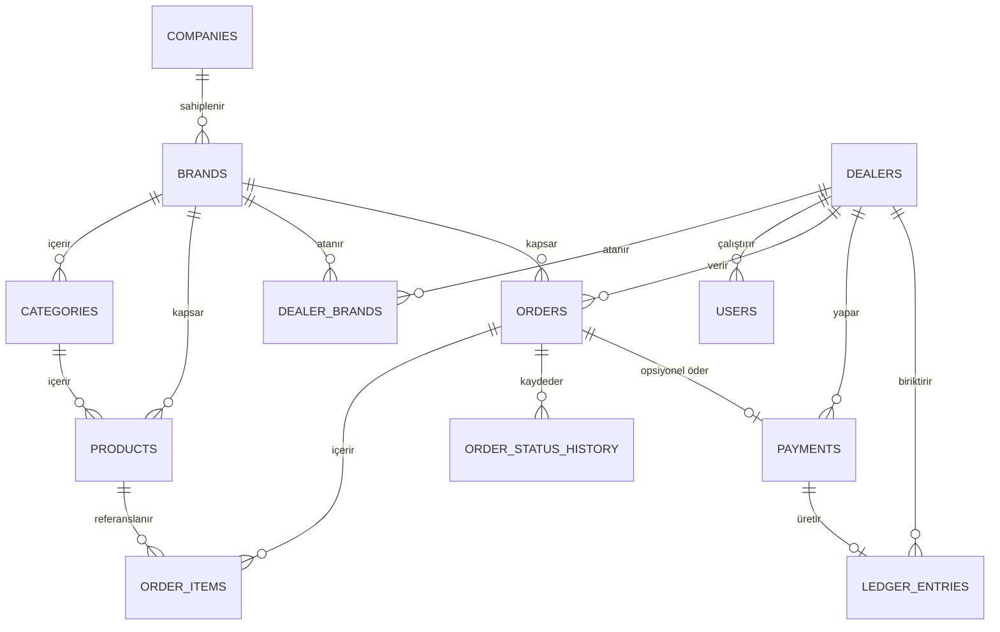
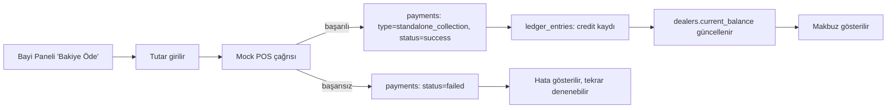

# HarmonyBlend (HB)

Fabrika/genel merkez ile franchise bayiler arasındaki sipariş, ödeme ve cari
tahsilat süreçlerini yöneten çok markalı bayi portalı. Bu doküman mimari,
veri modeli, iş akışı, teknoloji ve ekran planını içerir.

- **Kapsam** — Tunam çatısı altında çoklu alt marka (Musluoğlu, Dilim Börek)
- **Veritabanı** — Neon Postgres, ilk günden sabit
- **Ödeme** — Cari · Nakit/Kapıda Ödeme · Sanal POS (mock)

---

## 1. Fazlandırılmış Yol Haritası

Yedi faz; her biri bir öncekinin üstüne çalışır durumda kalacak şekilde
kurgulandı. Sanal POS entegrasyonu bilerek en sona bırakıldı — mock sağlayıcı
arayüzü Faz 3'te kurulduğu için Faz 6 bir "değiştirme" işlemi, yeniden yazma
değil. Aynı gerekçeyle bir ERP entegrasyonu ihtimali de en sona (Faz 7)
bırakıldı; Faz 4'teki sipariş düzenleme/silme özelliği bu ihtimali gözeterek
tasarlanacak (bkz. Faz 4 ve Faz 7 notları) ki ileride yeniden tasarlanmasın.

### Faz 1 — Temel Altyapı & Veri Modeli Kurulumu ✅ Tamamlandı

Hedef: Neon DB bağlantısı, ORM ve auth iskeleti — projenin geri kalanının
üstüne oturacağı zemin.

- Neon Postgres projesi + connection string'in ortam değişkenlerine
  tanımlanması (bir kere, kalıcı)
- Drizzle ORM kurulumu ve migration pipeline'ı
- `companies`, `brands`, `users`, `dealers`, `dealer_brands` ilk migration
- Rol bazlı auth iskeleti: firma admini, marka yöneticisi, bayi kullanıcısı

**Çıkış kriteri —** boş fakat çalışan bir admin girişi; veritabanına
yazma/okuma uçtan uca doğrulanmış.

### Faz 2 — Marka, Bayi ve Ürün Yönetimi ✅ Tamamlandı

Hedef: Admin panelin çekirdek CRUD ekranları; marka bazlı ayrışmanın veri
katmanında kurulması.

- Alt marka CRUD'u ve marka bazlı yetkilendirme
- Bayi CRUD'u + `dealer_brands` ataması
- Kategori/ürün CRUD'u — marka bazlı stok ve ambalaj alanlarıyla
- ~~`payment_methods` tanımları ve bayi/marka bazlı aktivasyon~~ — bu
  yaklaşım daha sonra tamamen kaldırıldı, bkz. Faz 3 sonundaki not

**Çıkış kriteri —** bir admin yeni bir bayiyi bir markaya bağlayıp, o bayinin
sadece o markanın kataloğunu gördüğünü doğrulayabiliyor.

### Faz 3 — Sipariş & Mock Ödeme Akışı ✅ Tamamlandı

Hedef: Bayi tarafında sepetten siparişe; ödeme tipine göre dallanan checkout
ve durum makinesi.

- Bayi kullanıcı hesabı oluşturma ekranı: admin bir bayiye kullanıcı
  adı/e-posta + şifre tanımlayıp `dealer_user` rolüyle giriş yapabilecek
  bir hesap açıyor (`/admin/dealers/[id]`) — önceden yalnızca elle
  (seed script) yapılabiliyordu.
- Sepet ve checkout ekranı (marka bazlı katalog)
- Ödeme tipine göre dinamik checkout adımları
- `orders` / `order_items` oluşturma, durum makinesi implementasyonu
- `PaymentProvider` arayüzü + `MockPosProvider`
- `order_status_history` ile denetim izi
- Toast bildirim sistemi (sipariş oluşturuldu / ödeme başarısız gibi
  başarı-hata mesajları için — `alert()`/`confirm()` yerine)
- Erişilebilirlik dokunuşları (`focus-visible` odak halkası,
  `prefers-reduced-motion` desteği)
- Sidebar menüsünü açılır/kapanır (daraltılabilir) yapma — admin ve bayi
  panelinde, tercih `localStorage`'da kalıcı
- Sidebar'ı sticky yapma — sayfa aşağı kaydırılsa bile kenar çubuğundaki
  öğeler sabit kalıyor, içerikle birlikte yukarı/aşağı kaymıyor
- Bayi listesinde "Düzenle" butonu — düzenleme artık ayrı bir sayfada
  değil, "Ekle" ile aynı 3 sekmeli modal üzerinden mevcut bayinin
  ayarları aynı yerden değiştirilebiliyor
- "Ekle/Düzenle" modalındaki maksimum bakiye limiti alanı para birimi
  formatlı (`CurrencyInput`) — düz sayı yerine otomatik binlik ayraç ve
  ₺ sembolüyle (`200.000₺`) gösteriliyor
- Bayi listesinde marka/durum filtre formu (`dealer-filter-form.tsx`)
- Admin → bayi kullanıcısı olarak giriş (impersonation): admin, bir
  bayinin panelini o bayi kullanıcısı kimliğiyle görüntüleyebiliyor
  (checkout/sipariş akışlarını bayi gözünden test etmek için). Kimlik
  değişimi NextAuth JWT `update` trigger'ı ile sunucu tarafında
  doğrulanıyor (`src/auth.ts`); bayi panelinde "orijinal hesaba dön"
  butonu ile geri dönülüyor. Roadmap'te öngörülmemiş, iş ihtiyacından
  doğan bir ek kapsamdı.
- Ödeme yöntemi aktivasyon sistemi (`payment_methods` /
  `dealer_payment_methods` tabloları, bayi/marka bazlı manuel açma-kapama)
  Faz 3 sonrasında tamamen kaldırıldı — Payna Grup Portal'ın aksine
  HarmonyBlend'in ERP entegrasyonu olmadığından bu ayrım gereksizdi. Artık
  her bayi cari/nakit/sanal POS'un hepsini kullanabiliyor; cari yalnızca
  mevcut bakiye + sipariş tutarı `maxBalanceLimit`'i aşarsa otomatik
  kapanıyor. `orders.payment_method_id` (FK) yerine sabit bir enum sütun
  (`orders.payment_method`) kullanılıyor.
- Toast bildirim sistemi admin paneline de genişletildi — marka/bayi/
  ürün/kategori/kullanıcı CRUD işlemleri ve sipariş durum geçişleri artık
  başarı/hata toast'ı gösteriyor (önceden yalnızca bayi tarafında vardı).
  Yeniden kullanılabilir `ToastForm` bileşeni (`src/components/
  toast-form.tsx`) ile server action'lar client tarafında çağrılıyor.
- Sipariş silme (admin) ve ürün/marka için "zorla sil" — normal silme,
  sipariş geçmişinde kullanılan ürün/markayı `order_items` FK'sinin
  engellemesiyle reddediyor (bkz. üstteki not); "zorla sil" önce o ürünü/
  markayı içeren siparişleri kaldırıp sonra siliyor. Yalnızca test/hatalı
  veri temizliği için düşünüldü — gerçek sipariş geçmişini silmek üzere
  kullanılmamalı. İki tıklamalı onay ile (`ConfirmDeleteButton`,
  native `confirm()` yerine).
- ~~Sipariş listesinden, detaya girmeden hızlı onay/red/iptal~~ — ✅
  Tamamlandı, roadmap dışı bir ek kapsam. Admin sipariş listesindeki her
  satıra durum makinesinin izin verdiği geçişlere göre ikon butonlar
  eklendi (`src/app/admin/orders/order-quick-actions.tsx`): onay tek
  tıkla (not gerekmiyor), red/iptal iki tıkla — ilk tık küçük bir sebep
  kutusu açar (sunucu tarafı bu durumlarda notu zorunlu tutuyor), ikinci
  tık (yeşil onay ikonu) o notla `transitionOrderStatus`'u çağırır.
- ~~Firma çapında "bayi siparişleri onay gerektirsin" ayarı~~ — ✅
  Tamamlandı, roadmap dışı bir ek kapsam. Yeni admin `/admin/settings`
  sayfası (yalnızca `company_admin` rolü değiştirebiliyor) ve
  `companies.requires_order_approval` sütunu (varsayılan `true`, mevcut
  davranışı bozmuyor). Kapalıyken `createOrder` cari/kapıda ödeme
  siparişlerini `submitted → approved`, sanal POS'ta ödeme başarılı
  olan siparişleri `paid → approved` durumuna otomatik geçiriyor
  (`changedBy: null`, sistem notu ile) — durum makinesindeki mevcut
  geçiş kurallarını genişletmeden, yalnızca kimin tetiklediğini
  değiştiriyor. Onaylanmış bir sipariş bu ayardan bağımsız olarak yine
  de iptal edilebiliyor çünkü `approved → cancelled` geçişi zaten her
  üç akışta da tanımlıydı.
- ~~Red/iptalde not zorunluluğu~~ — ✅ Tamamlandı. Yukarıdaki hızlı
  işlemlere ek olarak sipariş detay sayfasındaki tam durum geçiş formunda
  (`status-actions.tsx`) da red/iptal seçilirken not boşsa hem
  istemcide hem `transitionOrderStatus` sunucu tarafında reddediliyor —
  tek bir yerden atlanabilecek bir kural olmasın diye iki katmanlı.
- ~~Giriş öncesi firma seçimi (çoklu firma desteği)~~ — ✅ Tamamlandı,
  roadmap dışı bir ek kapsam. `companies` tablosuna `code` sütunu eklendi
  (`companies_code_unique`); ana sayfa artık doğrudan giriş formuna değil,
  bir firma kodu/adı giriş ekranına (`src/app/company-gate.tsx`) açılıyor.
  Seçilen firma `localStorage`'a (`hb_company_code`) önbelleklenip
  `/login?company=...`'a yönlendiriyor; `src/auth.ts`'teki `authorize`,
  kullanıcıyı artık yalnızca e-postayla değil `(email, companyId)`
  ikilisiyle arıyor — bu, aynı e-postanın farklı firmalarda ayrı
  hesaplara ait olabilmesini sağlıyor (`src/lib/companies.ts::
  resolveCompanyByCodeOrName`, kod büyük/küçük harf duyarsız, isim
  karşılaştırması da yapıyor). Kayıtlı firma artık geçersizse (silinmiş/
  yanlış) `/?companyError=1` ile ana sayfaya dönülüp önbellek temizleniyor.
  Bu değişiklik henüz yalnızca bir altyapı hazırlığı — bugün hâlâ tek bir
  firma (Tunam) çalışıyor, ama giriş akışı artık birden fazla firmayı
  ayrıştırabilecek şekilde kurulu.

**Çıkış kriteri —** üç ödeme tipiyle de (cari, kapıda ödeme, sanal POS
başarılı/başarısız) uçtan uca sipariş oluşturulabiliyor; admin panelde durum
geçişleri izlenebiliyor. Tarayıcıda doğrulandı.

- ~~Sipariş dökümanı (PDF)~~ — ✅ Tamamlandı, roadmap dışı bir ek kapsam.
  Sistemdeki tek PDF çıktısı olarak kasıtlı biçimde kapsamı dar tutuldu.
  Kullanıcının verdiği örnek eski-ERP çıktısına (depo/sevkiyat için ürün
  bazlı toplama listesi) benzer, ama modern ve markanın kendi kategori
  ağacını kullanan bir tasarım: firma/marka başlığı, bayi/tarih/sipariş no,
  ürünlerin sistemdeki kategoriye göre gruplanmış tablosu (kategori
  değişirse döküman otomatik güncellenir), boş "Sevk" kutucuğu (depo
  personeli elle işaretlesin diye) ve KDV dahil toplamlar
  (`src/lib/pdf/order-pdf.ts`, `src/lib/order-document.ts`). Üç giriş
  noktası: sipariş listesindeki her satırda tekli indirme ikonu, sipariş
  detay sayfasında "Sipariş Dökümanını İndir" butonu, ve siparişler
  sayfasının üstünde geçerli tablo filtresiyle (marka/durum/tarih aralığı)
  eşleşen tüm siparişleri tek bir PDF'te art arda üreten "PDF Olarak İndir"
  (`src/app/admin/orders/document/route.ts`) — filtre mantığı
  (`getFilteredOrderIds`) hem tabloda hem export'ta aynı. Türkçe karakterler
  (ş/ğ/ı/İ) için PT Sans fontu gömülü (`src/lib/pdf/fonts/`, SIL Open Font
  License — ücretsiz, projeye maliyeti yok). pdfkit'in normal girişi
  Next.js bundling'inde font-metrik dosyalarını bulamadığından
  (`ENOENT Helvetica.afm`) `pdfkit/js/pdfkit.standalone.js` kullanılıyor.
  CSV/Excel export zaten Faz 5'te var; ek PDF raporları (sayıca az,
  belirli) ileride ayrıca istenirse eklenecek.

### Faz 4 — Cari Bakiye & Bağımsız Tahsilat Modülü ✅ Tamamlandı

Hedef: Siparişten kopuk, serbest tutarlı ödeme ve cari hesap defteri.

- ~~Bayi panelinde "Bakiye Öde" ekranı~~ — ✅ Tamamlandı
  (`src/app/dealer/balance/`). Mevcut checkout'taki mock sanal POS deseniyle
  aynı: devre dışı sahte kart alanı + "başarısız simüle et" checkbox'ı.
  Bayi serbest bir tutar girip `mockPosProvider.charge()` ile öder.
- ~~`payments` tablosunda `type = standalone_collection` kaydı~~ — ✅
  Tamamlandı. `payBalance` action'ı (`src/app/dealer/balance/actions.ts`)
  `orderId: null` ile bu tipte bir satır yazıyor; `ChargeInput.orderId`
  bu yüzden opsiyonel yapıldı (`src/lib/payments/provider.ts`) — bağımsız
  tahsilatın bağlı olduğu bir sipariş yok.
- ~~`ledger_entries` defteri ve bakiye hesaplama~~ — ✅ Tamamlandı. Yeni
  tablo (`src/db/schema.ts`) + tek merkezi yazıcı `postLedgerEntry`
  (`src/lib/ledger.ts`) — her çağrı bir defter satırı yazıp
  `dealers.currentBalance` önbelleğini aynı anda günceller. Üç yazım
  noktası: cari sipariş oluşturulduğunda otomatik borç
  (`src/app/dealer/actions.ts::createOrder`), kapıda ödemesi tahsil
  edilemeyen siparişin (`delivered_unpaid`) cariye borç düşmesi
  (`src/app/admin/orders/actions.ts::transitionOrderStatus`), ve bağımsız
  bakiye ödemesinin alacak kaydı. Neon HTTP sürücüsünün gerçek transaction
  desteklememesi nedeniyle adımlar sırayla yazılıyor (Faz 3'teki
  `createOrder` yorumuyla aynı ödün). Cari bir sipariş reddedilir/iptal
  edilirse (`transitionOrderStatus`) ya da admin tarafından kalıcı silinirse
  (`deleteOrder`), oluşturulduğunda otomatik yazılan borç bir ters kayıtla
  (silmede `ledger_entries`'teki net bakiyeye göre hesaplanan
  `manual_adjustment`) dengeleniyor — aksi halde hiç gerçekleşmemiş sayılan
  bir siparişin borcu bayinin carisinde kalıcı olarak asılı kalırdı.
- ~~Admin tarafında cari hesap ekstresi görünümü~~ — ✅ Tamamlandı
  (`src/app/admin/dealers/[id]/ledger/page.tsx`) — bayi bazlı borç/alacak
  dökümü, her satırda o anki bakiye snapshot'ı. Bayi detay sayfasına
  güncel bakiyeyi gösteren bir "Cari Hesap" özet kartı + ekstre linki
  eklendi.
- ~~Bayi kataloğunda toplu ürün seçimi + tek işlemle sepete ekleme~~ — ✅
  Tamamlandı — Payna Grup Portal karşılaştırmasından gelen ek kapsam,
  katalog tarafında sipariş verme hızını artırır. Kataloğun sağ üstüne
  "Tüm miktarları temizle"nin yanına "Miktar Girilenleri Ekle" butonu
  eklendi (`product-catalog.tsx`): satır satır "Ekle"ye basmadan, miktar
  yazılmış tüm satırları tek tıkla sepete ekliyor; sepete zaten girmiş bir
  ürün atlanır (miktarları sessizce toplamak yerine), sipariş katına
  uymayan miktarlar da atlanır — her iki durumda da hangi ürünlerin
  neden eklenmediği toast ile bildiriliyor. Bunun için satır bazlı miktar
  state'i artık `ProductRow` içinde değil üst `ProductCatalog`'ta tutuluyor
  (kategori grupları arasında paylaşılabilsin diye); aynı tick içinde art
  arda çağrılan `addItem`'ların birbirinin üstüne yazmaması için
  `useCart`/`useLocalStorageStore` fonksiyonel updater (`prev => ...`)
  desenine geçirildi. Roadmap'te öngörülen ayrı bir "Ayarlar" sayfasıyla
  mod seçimine gerek kalmadı (bkz. aşağıdaki not) — tekli ve toplu ekleme
  her zaman yan yana duruyor.
- ~~"Tekrar sipariş ver"~~ — ✅ Tamamlandı, roadmap dışı bir ek kapsam.
  "Siparişlerim" listesinde ve sipariş detayında bir buton
  (`ReorderButton`), geçmiş bir siparişin kalemlerini o markanın
  sepetine kopyalar. Fiyat/KDV/kat gibi alanlar geçmiş siparişteki
  değerle değil, ürünün *güncel* değerleriyle kopyalanır
  (`getReorderItems`, `createOrder`'ın client fiyatına güvenmeyip
  sunucuda yeniden okuduğu aynı ilke); artık pasif bir ürün varsa o
  kalem atlanır ve kullanıcıya adıyla bildirilir (toast). Sepete
  eklendikten sonra drawer otomatik açılır, dealer miktarları gözden
  geçirip checkout'a geçer.
- ~~Ürün bazında sipariş katı (adet zorunluluğu)~~ — ✅ Tamamlandı,
  roadmap dışı bir ek kapsam. `products.order_multiple` (integer,
  `NOT NULL DEFAULT 1` — 1 = kısıtlama yok); admin
  ürün ekleme formunda ve `EditProductModal`'da düzenlenebiliyor, bir
  "grup" için aynı katın gruptaki her ürüne tek tek uygulanması yeterli
  (ör. "Kol Börekleri" kategorisindeki ürünlere tek tek 5 atanarak).
  Bayi kataloğunda ve sepet çekmecesinde miktar bu değerin katı değilse
  toast ile anlık uyarı gösterilir (input `step` değeri de kata göre
  ayarlanır); `createOrder` sunucu tarafında aynı kontrolü tekrarlayıp
  client'a güvenmeden reddeder — mevcut fiyat/KDV doğrulama deseniyle
  aynı ilke.
- ~~Sepette KDV tutarının ayrı bir satırda gösterilmesi~~ — ✅ Tamamlandı.
  KDV oranı ürün bazında değişken (`products.vat_rate`); sipariş kalemi
  oranı sipariş anında snapshot'lanıyor (`order_items.vat_rate`/
  `vat_amount`) ki ürünün oranı sonradan değişse geçmiş siparişler
  etkilenmesin. Sepet, checkout ve sipariş detay ekranlarında Ara Toplam/
  KDV/Genel Toplam kırılımı gösteriliyor; `orders.total_amount` artık net
  değil brüt (KDV dahil) tutar — cari limit kontrolü ve mock POS tutarı da
  buna göre brüt üzerinden çalışıyor.
- ~~Şifremi unuttum akışı~~ — ✅ Tamamlandı (mock-first). `EmailProvider`
  arayüzü + `MockEmailProvider` (`src/lib/email/`) — ödeme tarafındaki
  `PaymentProvider`/`MockPosProvider` deseniyle birebir aynı; gerçek mail
  gönderilmiyor, link geliştirici konsoluna yazılıyor. Tek kullanımlık,
  1 saatlik `password_reset_tokens` tablosu (ham token yerine SHA-256
  hash'i saklanıyor). Gerçek bir sağlayıcıya (ör. Resend) geçiş, Faz 6'daki
  ödeme sağlayıcısı geçişiyle aynı şekilde tek bir implementasyon
  eklenerek yapılacak — teknoloji yığınına henüz yeni bir servis
  eklenmedi.
- ~~Sepet ekranının sağdan açılan bir panel (drawer) olarak yeniden
  tasarlanması~~ — ✅ Tamamlandı. Sepet artık bayi panelinin her
  ekranından header'daki sepet ikonuyla erişilebilen, marka bazlı gruplu
  bir drawer (`src/app/dealer/cart-drawer.tsx`) — siparis.paynagrup.com'daki
  sepet deneyiminin karşılığı, roadmap dışı bir ek kapsamdı.
- ~~Admin ürün sayfasında "Ürünler" bölümünün "Kategoriler" bölümünün
  üstüne taşınması~~ — ✅ Tamamlandı.
- ~~Ürün tablosunda "Durum" ve "Sil" arasına bir "Düzenle" butonu~~ — ✅
  Tamamlandı. Bayi düzenleme modalıyla (`EditDealerModal`) aynı desen:
  `EditProductModal` (`src/app/admin/products/edit-product-modal.tsx`) —
  ad, SKU, birim, fiyat, KDV %, kategori ve aktif/pasif tek formdan
  güncelleniyor. Eskiden ayrı duran satır-içi KDV düzenleyici bu modalın
  içine taşındığı için kaldırıldı.
- ~~Bayinin kendi siparişini silebilmesi ya da düzenleyebilmesi~~ — ✅
  Tamamlandı. Fiziksel silme değil, durum geçişi (iptal) olarak çözüldü —
  amaç zaten bir bayinin hatalı/yanlış girilmiş bir siparişi iptal edip
  mevcut "Tekrar sipariş ver" ile tekrar sipariş geçebilmesiydi. Bayi
  panelinde ("Siparişlerim" listesi ve sipariş detayı) yeni bir
  "İptal Et" butonu (`src/app/dealer/orders/cancel-order-button.tsx`) —
  admin'in hızlı red/iptal deseniyle aynı iki adımlı etkileşim (ilk tık
  sebep kutusu açar, sunucu tarafı notu zorunlu tutar). Yeni
  `cancelOrder` server action'ı (`src/app/dealer/actions.ts`) sipariş
  sahipliğini doğruluyor ve durum makinesindeki mevcut
  `canTransitionOrderStatus` guard'ını (bkz. `src/lib/order-status.ts`)
  aynen kullanıyor — ek bir kısıtlama yazılmadı, zaten her üç akışta da
  `cancelled` geçişi yalnızca `submitted`/`approved`'ta tanımlı olduğundan
  bayi bir sipariş `preparing`'e geçtikten sonra artık iptal edemiyor.
  Cari siparişte oluşturulduğunda otomatik yazılan borç, admin'in
  `transitionOrderStatus`'undaki iptal/red bloğuyla birebir aynı desende
  (`postLedgerEntry` ile alacak kaydı, `sourceType: "order"`) geri
  alınıyor. **Faz 7 çakışma notu bu tasarımla karşılanmış oldu:** iptal
  edilebilirlik kontrolü tek bir yerde (`canTransitionOrderStatus`)
  toplandığı için, ileride eklenecek `orders.erp_synced_at` alanı bu
  fonksiyona üçüncü bir koşul olarak eklenmesi yeterli olacak, ayrı bir
  yeniden tasarım gerekmeyecek.
- ~~Bayi ürün kataloğunda hiyerarşik kategori gruplaması~~ — ✅ Tamamlandı,
  roadmap dışı bir ek kapsam. Kategoriler zaten kendine referans veren
  `parentId` ile (Faz 2) keyfi derinlikte dallanabiliyordu; eksik olan
  bunu bayi kataloğunda görsel olarak yansıtmaktı. `src/lib/
  category-tree.ts` (`buildCategoryTree`) düz kategori listesini ağaca
  çevirir, `src/app/dealer/product-catalog.tsx` bunu rekürsif render eder:
  bir ürün bir alt kategoriye atandığında (ör. "Boşnak Börekleri"), o ürün
  kataloğunda üst kategorinin ("Börekler") başlığı altında, kendi alt
  kategori başlığıyla girintili gösterilir; aynı kategorideki ürünler alt
  alta bir tabloda listelenir. Kategorisiz ürünler "Diğer" başlığı altında
  toplanır. Aynı gruplama; admin → Ürünler tablosu, sepet çekmecesi,
  checkout "Sepet Özeti", bayi "Siparişlerim" detayı ve admin sipariş
  detayı dahil ürün/sipariş kalemi listelenen **her** ekrana uygulandı —
  paylaşılan `src/components/category-group-list.tsx` (`CategoryGroupList`)
  bileşeni ağaç kurma + boş kategori dalını atlama mantığını tek yerde
  tutuyor, her ekran yalnızca kendi satır/tablo görünümünü
  (`renderItems`) sağlıyor. Sipariş kalemlerinin kategorisi, sipariş
  anında snapshot'lanmıyor — ürünün *o anki* kategorisi üzerinden
  gösteriliyor (fiyat/KDV'nin aksine, kategorizasyon parasal bir etkisi
  olmayan, salt görsel/organizasyonel bir alan olduğundan kasıtlı bir
  tercih). "Kategori" sütunu artık tekrar etmiyor, yerini gruplama
  alıyor.
- Bayi kataloğunda "Ekle" satırındaki miktar alanının varsayılanı 1 yerine
  0 yapıldı — yanlışlıkla "Ekle"ye basılıp 1 adet eklenmesini önlemek
  için; miktar 0 iken "Ekle"ye basılırsa "Lütfen bir miktar girin" hatası
  gösterilir.
- Bayi kataloğuna "Tüm miktarları temizle" butonu eklendi (ürün
  listesinin sağ üstünde) — henüz sepete eklenmemiş, sadece o an girilmiş
  miktar alanlarını sıfırlar.
- Header'daki sepet ikonunun yanına "Sepeti boşalt" eklendi — tüm
  markalardaki sepeti tek seferde boşaltır (`CartContext.clearCart`);
  sepet boşken tıklanamaz durumda (soluk/pasif).
- ~~Bayi paneli menüsüne bir "Ayarlar" sayfası (sepete ekleme modu
  seçimi)~~ — farklı şekilde çözüldü, ayrı bir sayfa/ayar gerekmedi.
  Planlanan Mod 1 (satır satır "Ekle") ve Mod 2 (toplu ekleme), bir
  tercih anahtarı arkasında seçtirilmek yerine yukarıdaki "Miktar
  Girilenleri Ekle" özelliğiyle **her zaman birlikte** sunuldu — bayi
  istediği satırda tek tek "Ekle"ye basabiliyor, istediği zaman birden
  fazla satıra miktar yazıp tek butonla topluca ekleyebiliyor. Bir
  ayar ekranı ve kalıcı tercih deposu (localStorage/`users` tablosu)
  ihtiyacını ortadan kaldırdığı için daha basit bir çözüm.
- ~~Admin ve bayi paneli "Genel Bakış" ekranlarına gerçek KPI ve grafik
  içeriği~~ — ✅ Tamamlandı, roadmap dışı bir ek kapsam (bkz. Bölüm 5,
  "Genel Bakış" satırı — önceden yalnızca statik sayaç kartları vardı).
  Paylaşılan `StatTile` (`src/components/stat-tile.tsx`) ve `BarChart`
  (`src/components/bar-chart.tsx`) bileşenleri + `src/lib/month-range.ts`
  (son N ayın kovaları) ve `src/lib/format.ts` (para/sayı biçimlendirme)
  yardımcıları eklendi. Admin ana sayfası: bayi/ürün sayısı, bu ay sipariş
  sayısı/cirosu, toplam cari alacak KPI'ları + son 6 ay sipariş sayısı ve
  ciro trend grafikleri + bu ay kategori bazında en çok sipariş edilen
  ürünler tablosu. Bayi ana sayfası aynı desende kendi verisiyle: bu ay
  sipariş sayısı/tutarı, güncel cari bakiye, kalan cari limit + aynı trend
  grafikleri ve kategori bazlı en çok sipariş verdiği ürünler. İptal/
  reddedilen siparişler istatistiklerden hariç tutuluyor
  (`src/lib/order-status.ts::EXCLUDED_FROM_STATS_STATUSES`) ama teslim
  edilip tahsil edilemeyen (`delivered_unpaid`) siparişler fiilen
  gerçekleştiği için dahil tutuluyor. Bayi tarafında ürün kataloğu artık
  ayrı bir sayfaya taşındı (`/dealer/catalog`), `/dealer` bu genel bakış
  ekranına ayrıldı; bayi menüsüne "Genel Bakış" ve "Bakiye Öde" eklendi,
  admin menüsüne "Ayarlar" eklendi.

**Çıkış kriteri —** bir bayi siparişsiz şekilde mock POS ile ödeme yapıyor ve
cari bakiyesinin anında güncellendiğini görüyor.

### Faz 5 — Raporlama & Analitik ✅ Tamamlandı

Hedef: Filtrelenebilir, dışa aktarılabilir raporlama motoru.

- ~~Marka / tarih aralığı filtreleriyle dinamik tablo ve grafikler~~ — ✅
  Tamamlandı. Ürün bazlı filtre şimdilik kapsam dışı bırakıldı; bayi bazlı
  filtre de eklenmedi — bayiler raporlarda sadece gruplanmış çıktı (en çok
  sipariş/ciro yapan bayiler) olarak görünüyor, filtre girdisi değil.
  Admin genel bakış (`src/app/admin/page.tsx`) ve siparişler
  (`src/app/admin/orders/`) ekranlarına dönem filtresi
  (`src/components/period-filter.tsx`, `src/lib/date-range.ts`) ve marka
  filtresi (`src/components/brand-filter-buttons.tsx`,
  `src/components/by-brand-toggle.tsx`) eklendi; grafikler seçilen döneme
  göre saat/gün/hafta/ay bucket'larına bölünüyor
  (`src/lib/chart-buckets.ts`, `src/components/grouped-bar-chart.tsx`).
- ~~Excel (.xlsx) export~~ — ✅ Tamamlandı, sadece Excel ile — CSV şimdilik
  kapsam dışı, PDF ise ileride sayısı az birkaç belirli rapor için ayrıca
  ele alınacak. Yeni `/admin/reports` sayfası (`src/app/admin/reports/`)
  altında marka bazlı satış raporu ve pasif bayi raporu için birer
  "Excel'e Aktar" butonu; indirme, seçili filtrelerle aynı sorguyu tekrar
  çalıştırıp `exceljs` ile `.xlsx` üreten bir route handler'dan geçiyor
  (`src/app/admin/reports/export/route.ts`). Rapor sorguları
  `src/lib/reports.ts`'te toplandı ki sayfa ve export handler'ı aynı
  mantığı kullansın.
- ~~Sipariş vermeyen bayi raporu~~ — ✅ Tamamlandı — pasif bayi takibi için
  Payna Grup Portal karşılaştırmasından gelen ek kapsam. `/admin/reports`
  sayfasında Bugün / Dün / 1 Hafta / 2 Hafta (en sıkı uç) eşiği seçilebiliyor
  (`src/lib/inactive-threshold.ts`, `src/app/admin/reports/reports-filters.tsx`);
  hiç sipariş vermemiş ya da eşik gün sayısından uzun süredir sipariş vermemiş bayiler, hangi
  marka(lar)a bağlı oldukları ve son sipariş tarihiyle birlikte listeleniyor
  (`getInactiveDealersReport`, `src/lib/reports.ts`). İptal/red edilen
  siparişler "sipariş verdi" sayılmıyor — genel bakış istatistikleriyle
  aynı kural (`EXCLUDED_FROM_STATS_STATUSES`).

Kapsam dışı bırakıldı: büyüyen veri hacmi için özet tablo / materialized
view stratejisi — genel bakış grafikleri mevcut hacimde yeterli
performans sağlıyor, ileride ihtiyaç olursa ayrı bir işe konu edilecek.

**Çıkış kriteri —** bir firma yetkilisi son üç ayın marka bazlı satışlarını
filtreleyip Excel'e aktarabiliyor.

### Faz 6 — Canlı Sanal POS Entegrasyonu & Sertleştirme

Hedef: Mock sağlayıcının gerçek bir bankayla değiştirilmesi ve production
sertleştirme.

- `PaymentProvider` arayüzünün gerçek sağlayıcı (Iyzico/Paytr/banka API)
  implementasyonu
- Webhook/callback doğrulama, 3D Secure akışı
- Yük testi, hata izleme, yedekleme/felaket kurtarma planı

**Çıkış kriteri —** canlı ortamda gerçek bir kartla uçtan uca ödeme
tamamlanabiliyor; mock sağlayıcı hiçbir çağıran kodu değiştirmeden devre dışı
kalabiliyor.

### Faz 7 — ERP Entegrasyonu

Hedef: Onaylanan siparişlerin şirketin ERP sistemine tek yönlü aktarımı;
hangi ERP'ye bağlanılacağı henüz belli olmadığından `PaymentProvider`/
`EmailProvider` ile aynı desende bir soyutlama kurulup gerçek bağlayıcı
sonradan eklenecek.

- `ErpSyncProvider` arayüzü + `MockErpSyncProvider` (gerçek ERP
  seçilene kadar konsola/loglara yazan sahte implementasyon) —
  `src/lib/payments/`, `src/lib/email/` ile aynı desen
- `orders.erp_synced_at` (nullable timestamp) ve `orders.erp_reference`
  (ERP tarafındaki kayıt kimliği) alanları
- **Tek yönlü** aktarım (yerel → ERP); ERP'nin siparişi kendi tarafında
  değiştirip bunu geri yansıtması (webhook/pull + çakışma çözümü)
  kapsam dışı — hangi ERP'ye bağlanılacağı bilinmeden bu yönde tasarım
  yapmak erken olur
- Sipariş, `erp_synced_at` dolduktan sonra yerelde salt-okunur olur: ne
  Faz 4'teki bayi düzenleme/silme özelliği ne admin'in normal silmesi
  bu siparişe dokunabilir (yalnızca test verisi temizliği amaçlı
  "zorla sil" dahi ERP'ye aktarılmış gerçek siparişlerde
  kullanılmamalı — bkz. Faz 4 notu). Düzeltme ihtiyacı iptal + yeni
  sipariş ile çözülür
- Hangi durumdaki siparişlerin otomatik/manuel aktarılacağı (ör.
  yalnızca `approved`/`paid` sonrası) ve aktarım tetikleyicisi
  (durum geçişinde otomatik mi, admin panelden manuel "ERP'ye
  Aktar" butonuyla mı) uygulama aşamasında netleştirilecek

**Çıkış kriteri —** onaylanan bir sipariş (mock) ERP'ye aktarılıyor,
aktarılan sipariş yerelde düzenleme/silme denemesinde reddediliyor; mock
sağlayıcı hiçbir çağıran kodu değiştirmeden gerçek ERP bağlayıcısıyla
değiştirilebiliyor.

### Faz 8 — Kullanıcı Rolleri, Kullanıcılar Sayfası & Bölgesel Yetkilendirme

Hedef: Bayiye bağlı olmayan head-office kullanıcıları (bölge müdürü,
muhasebeci, raporlamacı vb.) için ayrı roller, bunları yönetecek bir
Kullanıcılar sayfası ve bölge bazlı, admin tarafından değiştirilebilir
bir yetkilendirme modeli. Dört bağımlı alt adıma ayrılıyor — her biri
bir öncekinin üstüne çalışıyor.

**8.1 — Kullanıcılar sayfası & yeni roller**
- `USER_ROLES` genişletilir: bölge müdürü, muhasebeci, raporlamacı
  eklenir (rol slug'ları uygulama aşamasında netleşecek — ör.
  `regional_manager` / `accountant` / `reporter`)
- Yeni `/admin/users` (Kullanıcılar) sayfası: yalnızca `dealerId = NULL`
  olan head-office kullanıcılarını listeler (`company_admin`,
  `brand_manager`, yeni roller) — bayi kullanıcıları (`dealer_user`) bu
  sayfada hiç görünmez, kullanıcı bilerek Markalar & Bayiler'e
  yönlendirilir
- Kullanıcı oluşturma iki yerden mümkün olmaya devam eder — Markalar &
  Bayiler'deki mevcut modal (tüm roller, bayi dahil) ve yeni Kullanıcılar
  sayfasındaki form (yalnızca head-office rolleri, bayi/dealer_user
  seçeneği sunulmaz) — ikisi de aynı `createDealerOrUser` action'ını
  paylaşır. Yeni bir bayi/marka oluşturmak için kullanıcı her zaman
  Markalar & Bayiler sayfasına yönlendirilir.
- ~~`/admin/users` sayfasının yeri ayrıldı~~ — ✅ Kısmen. Nav'a "Kullanıcılar"
  eklendi, rota "Yapım aşamasında" yer tutucusu gösteriyor
  (`src/components/coming-soon.tsx`) — 8.1'in geri kalanı (gerçek liste,
  yeni roller, form) henüz yapılmadı.

**8.2 — Bölge tanımı & atanabilir erişim**
- Bölge müdürü gibi rollerin "hangi bölge(ler)e erişimi var" bilgisini
  tutan yeni bir ilişki tablosu (ör. `user_region_access`: userId,
  bölge) — `dealers.bolge` alanındaki (bugün serbest metin, sabitlenmemiş)
  değerlerle eşleşir
- Bir kullanıcı birden fazla bölgeye atanabilir ve bu atama admin
  tarafından her zaman değiştirilebilir — ör. Avrupa Yakası'ndaki bölge
  müdürü ayrılırsa, Anadolu Yakası'ndaki müdüre Avrupa Yakası erişimi de
  eklenebilir
- Kullanıcılar sayfasında bölge kısıtlı bir kullanıcıyı düzenlerken
  "Erişebileceği Bölgeler" çoklu seçim alanı

**8.3 — Bölge bazlı veri kapsamı (scoping)**
- Oturum modeli (`src/lib/session.ts`), kullanıcının bölge erişim
  listesini taşıyacak şekilde genişletilir
- Bayiler, Siparişler, Raporlar, Genel Bakış sorguları — bölge kısıtlı
  bir rol için otomatik olarak yalnızca erişilebilir bölgelerdeki
  bayi/sipariş verisini döndürür; `company_admin`/`brand_manager`
  kısıtlanmaz
- Kısıtlama sunucu tarafında (route/query seviyesinde) uygulanır, yalnızca
  arayüzde gizleme değil — başka bölgenin sipariş id'sine doğrudan URL ile
  gidilse bile erişim reddedilir

**8.4 — Rol bazlı ince yetkiler (açılıp kapanabilir izinler)**
- Basit rol üyeliği yetmiyor — "bu rol sipariş silebilir mi" gibi admin
  tarafından açılıp kapatılabilen izinler gerekiyor
- Yeni bir izin modeli (ör. rol + izin anahtarı + açık/kapalı) ve
  Ayarlar sayfasında rol bazlı bir izin matrisi
- İlk izin: **Sipariş Silme** — bölge müdürü/muhasebeci gibi roller için
  varsayılan kapalı, admin `/admin/settings`'ten açıp kapatabilir

**Çıkış kriteri —** bölge müdürü/muhasebeci/raporlamacı hesabıyla giriş
yapıldığında yalnızca yetkili olunan bölge/marka verisi görünüyor; admin
bu bölge erişimini ve ek izinleri (sipariş silme gibi) Kullanıcılar/
Ayarlar sayfalarından istediği zaman değiştirebiliyor; bayi kullanıcıları
hâlâ yalnızca Markalar & Bayiler'den yönetiliyor.

### Faz 9 — Ek Operasyonel Sayfalar (Gün Sonu, Sipariş Detaylı, Dış Sipariş)

Hedef: Operasyonel ekibin ihtiyaç duyduğu, birbirinden bağımsız üç yeni
sayfa. Yalnızca admin'e değil **bayi paneline de** açık — bayiler kendi
verilerine bakabilir, firma geneline değil (admin/marka yöneticisi her
zamanki gibi tam görür). Sayfa iskeletleri ve nav girişleri iki tarafta
da şimdiden eklendi (`src/app/admin/end-of-day/`,
`src/app/admin/order-details/`, `src/app/admin/external-orders/` ve
bunların `src/app/dealer/` altındaki eşleri — hepsi ortak `ComingSoon`
bileşeniyle "Yapım aşamasında" gösteriyor) — bu fazın kapsamı gerçek
işlevi uygulamak.

- **Gün Sonu** (`/admin/end-of-day`, `/dealer/end-of-day`) — günlük
  kapanış özeti/mutabakat: o gün alınan siparişlerin ödeme tipine göre
  (cari/kapıda ödeme/sanal POS) dökümü, tahsil edilen/edilemeyen
  tutarlar. Bayi tarafında yalnızca kendi siparişleri. Kapsam (bir
  "günü kapatma" aksiyonu olup olmayacağı) uygulama aşamasında
  netleşecek
- **Sipariş (Detaylı)** (`/admin/order-details`, `/dealer/order-details`)
  — sipariş kalemi bazında (mevcut sipariş listesinin aksine)
  filtrelenebilir bir görünüm; hangi ürün hangi bayiye ne zaman gitmiş
  sorgusunu tek satırda cevaplar. Bayi tarafında yalnızca kendi
  siparişlerinin kalemleri
- **Dış Sipariş** (`/admin/external-orders`, `/dealer/external-orders`)
  — sistem dışından (telefon, e-posta vb.) gelen siparişlerin elle
  girilmesi; mevcut sipariş modeliyle (ürün/bayi/ödeme tipi) aynı
  şemayı kullanır, yalnızca giriş noktası farklı. Bayi kendi dış
  siparişini girip görebilir, başka bayininkini göremez

**Çıkış kriteri —** üç sayfa da hem admin hem bayi panelinde gerçek
veriyle çalışıyor; bayi girişinde veri kendi kaydıyla sınırlı; "Yapım
aşamasında" yer tutucusu kaldırılmış.

### Faz 10 — Responsive Tasarım ✅ Tamamlandı

Hedef: Site mobil/tablet ekranlarda kullanılabilir hale gelsin.

- ~~10.1 — Mobil sidebar~~ — ✅ Tamamlandı. Paylaşılan
  `src/components/mobile-nav-context.tsx` (`MobileNavProvider`/
  `useMobileNav`, dealer'daki `CartProvider`/`useCart` deseniyle aynı) +
  `mobile-nav-toggle.tsx` (hamburger, `CartDrawerTrigger` ikon
  butonuyla aynı stil). `md` altında admin/dealer sidebar'ları
  (`sidebar.tsx`) `fixed`+`-translate-x-full`/`translate-x-0` ile
  off-canvas'a dönüyor, karartılmış bir backdrop'la (`md:hidden`)
  açılıp kapanıyor, rota değişince otomatik kapanıyor; `md` ve üstünde
  önceki sticky/daraltılabilir davranış birebir korunuyor (mobilde
  masaüstü "daralt" tercihi görmezden geliniyor, o zaten tüm genişlikte
  açılan bir overlay). Header'lar (`admin/layout.tsx`,
  `dealer/layout.tsx`) da daraltıldı: tarih `sm` altında gizleniyor,
  e-posta `truncate`, `main`/`header` padding'i `px-4`'e düşüyor.
- ~~10.2 — Tablo taşmalarını sarmala~~ — ✅ Tamamlandı. 12 dosyadaki 17
  `<table>` de `overflow-x-auto` kapsayıcıya alındı. Bunu yaparken asıl
  hata ortaya çıktı: `admin/layout.tsx`/`dealer/layout.tsx`'teki iç içe
  `flex flex-1` kapsayıcılarında `min-w-0` olmadığından, tablo
  sarmalayıcısı içeride doğru scroll etse bile üstteki flex zincirinin
  `min-width: auto` varsayılanı yüzünden **tüm sayfa** yatay kaydırma
  kazanıyordu — 375px'te fark edilmeyen ama gerçek cihazda görülecek bir
  bug. `min-w-0` hem `<div className="flex ... flex-col">` sarmalayıcıya
  hem `<main>`'e eklenerek çözüldü.
- ~~10.3 — Sayfa/grid düzenlerini gözden geçir~~ — ✅ Tamamlandı. Sabit
  `grid-cols-2` form grid'leri (`add-user-modal.tsx` ×4,
  `edit-product-modal.tsx` ×2, `dealers/[id]/page.tsx` ×1)
  `grid-cols-1 sm:grid-cols-2` yapıldı. Filtre/araç çubukları
  (`period-filter.tsx`, `brand-filter-buttons.tsx`,
  `dealer-filter-form.tsx`) zaten `flex-wrap` kullanıyordu, değişiklik
  gerekmedi; stat kartı grid'leri (`admin/page.tsx`, `dealer/page.tsx`,
  `ledger/page.tsx`) zaten responsive'ti.

**Çıkış kriteri —** admin ve dealer panelleri bir telefon ekranında
(375px genişlik) yatay kaydırma gerektirmeden, sidebar erişilebilir
şekilde kullanılabiliyor. Chrome'da 557px genişlikte hem admin hem bayi
(impersonation ile) oturumunda uçtan uca doğrulandı: hamburger/drawer/
backdrop akışı, tablo scroll'ları, modal grid stack'i; masaüstünde
(1400px) önceki davranış (sticky sidebar, daralt/genişlet) değişmeden
kaldı.

### Faz 11 — Bayi Denetim (Stok Mutabakatı)

Hedef: Musluoğlu markasının aylık bayi stok sayımı/satış mutabakatını
şu an elle yürüttüğü Excel dosyasının (24 şube sekmesi, kırılgan
`INDIRECT`/`VLOOKUP` formülleri, versiyon kontrolü yok) yerini alacak
bir modül. Sayfa iskeletleri ve nav girişleri şimdiden eklendi
(`src/app/admin/audit/`, `src/app/dealer/audit/` — `ComingSoon`
bileşeniyle "Yapım aşamasında" gösteriyor); bu fazın kapsamı gerçek
işlevi uygulamak. Kapsam v1'de **yalnızca Musluoğlu markası** (30 ürün,
24 bayi — zaten `brands`/`products`/`categories`/`dealers`'ta kayıtlı,
yeniden oluşturulmayacak).

**İş mantığı** (Excel'den çıkarıldı, gerçek bir satırla doğrulandı —
DEMETEVLER/CEVİZLİ BAKLAVA: 17.545+159×3.6−24.07−18.8=547.075 →
×1.08(kutu)=590.841 → ×0.99(Ankara sapma)=584.93, Excel'deki hücreyle
birebir eşleşiyor): bayi dönem başına ürün bazlı 5 değer girer —
Dönem Başı Sayım(kg), Alım(tepsi), Fire(kg), Dönem Sonu Sayım(kg),
Satılan(kg) — artı dönem başına Diğer Satışlar (TL, örn. gramajlı
dondurma satışları/poşet/kutu) ve Mevcut Ciro (kasadan okunan gerçek
ciro). Sistem hesaplar: `Alım(kg)=Alım(tepsi)×Tepsi Kg` →
`Satılması Gereken=Başı+Alım(kg)−Fire−Sonu` →
`Kutu Dahil=×(1+Kutu Oranı)` →
`Net Beklenen=Kutu Dahil×(1−Sapma Oranı)` (**Börekler kategorisinde
sapma düşülmez**) → `Fark(kg)=Satılan−Net Beklenen`,
`Fark(TL)=Fark×Fiyat`; dönem toplamında "Yapması Gereken Ciro"
(=Σ Net Beklenen×Fiyat + Diğer Satışlar), "Mevcut Ciro" ile
karşılaştırılır. Kutu Oranı %8 sabit; Sapma Oranı bölgeye göre değişir
(Excel'de Ankara %1, İstanbul %3).

**Kilit akışı:** bayi verisini girer → "Gönder ve Kilitle" ile kilitler
→ kilitliyken salt-okunur → sadece admin kilidi açabilir → açıldıktan
sonra bayi veya admin düzenleyebilir.

**Veri modeli (taslak):**
- `products.trayWeightKg` — tepsi ağırlığı (kg), sadece denetime dahil
  ürünlerde dolu
- `auditRegions` — bölge + kutu/sapma oranı; `dealers.auditRegionId`
  ile bağlanır (mevcut `dealers.il`/`bolge` alanları tutarsız/boş
  olduğu için ayrı bir bölge kavramı gerekiyor)
- `auditPeriods` — dönem (başlangıç/bitiş), admin açar; bir dönem tüm
  Musluoğlu bayilerini aynı anda kapsar
- `auditEntries` — bayi+dönem başına 1 satır: durum (taslak/kilitli),
  kutu/sapma oranı snapshot'ı (oranlar sonradan değişse bile geçmiş
  denetim etkilenmesin diye — `orderItems.vatRate` snapshot deseniyle
  aynı mantık), Mevcut Ciro, gönderim/kilit açma izleri. Yeni dönem
  açıldığında Dönem Başı Sayım, bir önceki dönemin Dönem Sonu
  Sayım'ından otomatik devreder (düzenlenebilir)
- `auditEntryItems` — bayi+dönem+ürün başına 5 girdi alanı; hesaplanan
  alanlar (Alım kg, Fark kg/TL, ciro vb.) saklanmaz, `products.unitPrice`
  ve oran snapshot'larından anlık hesaplanır (Excel'deki ayrı
  fiyat-geçmişi listesi kullanılmaz, basitleştirilir)
- `auditOtherSaleTypes` + `auditEntryOtherSales` — admin yönetimli
  diğer satış kalemleri (sabit liste değil)

**Sayfa planı:**
- `/dealer/audit` — kategoriye göre gruplanmış giriş formu (Tatlılar/
  Börekler), diğer satışlar, Mevcut Ciro, "Gönder ve Kilitle" butonu;
  kilitliyken salt-okunur + geçmiş dönemler
- `/admin/audit` — dönem aç/kapa, bayi durum tablosu (gönderilmedi/
  taslak/kilitli), kilit aç, bölge bazlı İCMAL-benzeri karşılaştırma
  tablosu (Yapması Gereken / Mevcut Ciro / Fark) + grafikler (bayi
  bazlı fark, bölge bazlı ciro karşılaştırması — repo'da hiç chart
  kütüphanesi yok, `recharts` eklenmesi öneriliyor); ayrıca bölge/oran
  ve diğer-satış-kalemi yönetimi için küçük bir ayarlar bölümü
- Bayi düzenleme sayfasına (`/admin/dealers/[id]`) "Denetim Bölgesi"
  seçici, ürün düzenleme modaline "Tepsi Kg" alanı eklenir

**Çıkış kriteri —** her iki panelde de gerçek veriyle çalışıyor; kilit
akışı uçtan uca doğrulanmış; bölge/bayi karşılaştırma tablosu ve
grafikler doğru rakamları gösteriyor; "Yapım aşamasında" yer tutucusu
kaldırılmış.

---

## 2. Veri Modeli

PostgreSQL / Neon DB uyumlu. Marka bazlı ayrışma her katalog ve stok
tablosunda `brand_id` ile; sipariş içi/dışı ödeme ayrımı
`payments.order_id`'nin null olup olmamasıyla sağlanıyor.



### Kimlik & kiracı yapısı

```
companies
  id            uuid        PK
  name          text
  created_at    timestamptz

brands
  id            uuid        PK
  company_id    uuid        FK -> companies.id
  name          text
  slug          text        UNIQUE
  created_at    timestamptz

dealers
  id                  uuid        PK
  company_id          uuid        FK -> companies.id
  name                text
  tax_no              text
  address             text
  max_balance_limit    numeric(14,2)  NULL   -- NULL = limitsiz; aşılırsa cari kapanır
  current_balance     numeric(14,2)  DEFAULT 0   -- ledger_entries'ten türeyen önbellek
  created_at          timestamptz

dealer_brands
  id            uuid        PK
  dealer_id     uuid        FK -> dealers.id
  brand_id      uuid        FK -> brands.id
  is_active     boolean     DEFAULT true
  UNIQUE(dealer_id, brand_id)

users
  id            uuid        PK
  company_id    uuid        FK -> companies.id
  dealer_id     uuid        FK -> dealers.id   NULL -- null ise firma çalışanı
  email         text        UNIQUE
  role          enum(company_admin, brand_manager, dealer_user)
  password_hash text
  created_at    timestamptz
```

### Katalog

```
categories
  id            uuid        PK
  brand_id      uuid        FK -> brands.id
  parent_id     uuid        FK -> categories.id   NULL -- alt kategori için self-reference
  name          text

products
  id            uuid        PK
  brand_id      uuid        FK -> brands.id
  category_id   uuid        FK -> categories.id
  sku           text
  name          text
  unit          text        -- koli / kg / adet
  unit_price    numeric(12,2)
  is_active     boolean     DEFAULT true
  created_at    timestamptz
```

### Sipariş

```
orders
  id                  uuid        PK
  dealer_id           uuid        FK -> dealers.id
  brand_id            uuid        FK -> brands.id
  payment_method      enum(cari, cash_on_delivery, virtual_pos)
  status              text        -- bkz. Bölüm 3, durum makinesi
  total_amount        numeric(14,2)
  created_by          uuid        FK -> users.id
  created_at          timestamptz
  updated_at          timestamptz

order_items
  id            uuid        PK
  order_id      uuid        FK -> orders.id
  product_id    uuid        FK -> products.id
  quantity      numeric(10,2)
  unit_price    numeric(12,2)
  line_total    numeric(14,2)

order_status_history
  id            uuid        PK
  order_id      uuid        FK -> orders.id
  from_status   text
  to_status     text
  changed_by    uuid        FK -> users.id   NULL -- sistem tetiklemesiyse boş
  note          text
  created_at    timestamptz
```

### Ödeme & cari hareket

```
payments
  id              uuid        PK
  dealer_id       uuid        FK -> dealers.id
  order_id        uuid        FK -> orders.id   NULL -- null ise sipariş dışı bağımsız tahsilat
  type            enum(order_payment, standalone_collection)
  provider        enum(mock, iyzico, paytr)
  amount          numeric(14,2)
  status          enum(pending, success, failed, refunded)
  provider_ref    text        NULL -- banka/POS işlem referansı
  created_at      timestamptz

ledger_entries
  id              uuid        PK
  dealer_id       uuid        FK -> dealers.id
  direction       enum(debit, credit)   -- borç / alacak
  amount          numeric(14,2)
  source_type     enum(order, payment, manual_adjustment)
  source_id       uuid        NULL -- kaynak kayda referans
  balance_after   numeric(14,2)
  created_at      timestamptz
```

> **Neden ayrı bir ledger_entries?** `dealers.current_balance` sık okunan bir
> önbellektir; gerçek kaynak `ledger_entries`'teki hareket geçmişidir. Bu
> ayrım, cari ekstresinin her zaman yeniden hesaplanabilir/denetlenebilir
> olmasını sağlar.

---

## 3. Sipariş & Tahsilat Akış Algoritması

Sipariş durum makinesi, checkout anında seçilen `payment_method`'a göre üç
ayrı yola dallanır. Her geçiş `order_status_history`'ye yazılır.

**Cari (Açık Hesap):** draft → submitted → approved → preparing → shipped →
delivered → closed. (approved öncesi: cancelled / rejected)

**Nakit / Kapıda Ödeme:** draft → submitted → approved → preparing → shipped
→ awaiting_cash_collection → delivered_paid → closed. (tahsil edilemezse:
ledger'a borç düşülür, "Bakiye Öde" ile kapanır)

**Sanal POS (Mock):** draft → awaiting_payment → paid → approved → preparing
→ shipped → delivered → closed. (POS başarısız: payment_failed → retry /
cancelled)

> **Kural:** Sanal POS akışında sipariş, ödeme `success` dönmeden `approved`
> durumuna geçemez — hazırlık süreci ödemeyle kilitlenir. Cari akışında ödeme
> adımı yoktur; onay doğrudan hazırlık sürecini tetikler.

### Sipariş Dışı Bağımsız Sanal POS Tahsilatı

Bayi, herhangi bir siparişe bağlı olmadan cari bakiyesini kapatmak için
serbest tutar girip mock POS üzerinden öder. Bu akış `orders` tablosuna hiç
dokunmaz.



---

## 4. Önerilen Teknoloji Yığını

Tek ekip / hızlı iterasyon senaryosuna göre optimize edildi: Next.js tabanlı
tek bir monolit, Neon'un serverless doğasına uygun bir ORM.

| Katman | Öneri | Gerekçe |
|---|---|---|
| Frontend / Backend | Next.js 15 (App Router) + TypeScript | Server Actions ile admin/bayi panellerini tek repo'da tutar; Vercel + Neon entegrasyonu native. |
| UI Katmanı | Tailwind CSS + shadcn/ui | Kurumsal tablo/form yoğun ekranlar için hızlı, erişilebilir bileşen tabanı. |
| Veri getirme | TanStack Query + Server Actions | Sipariş/rapor ekranlarında optimistic update ve cache invalidation. |
| ORM | Drizzle ORM | Neon'un serverless sürücüsüyle edge-uyumlu, SQL'e yakın; Prisma'ya göre soğuk başlangıç maliyeti düşük. |
| Veritabanı | Neon Postgres | Zorunlu kısıt. Branch özelliği dev/staging izolasyonu için ayrıca faydalı. |
| Kimlik doğrulama | Auth.js (credentials) + rol bazlı middleware | Firma admini / marka yöneticisi / bayi kullanıcısı ayrımı route seviyesinde uygulanır. |
| Önbellekleme | Upstash Redis | Serverless uyumlu; rapor sorgu sonuçları ve oturum verisi için. |
| Excel / CSV export | exceljs, csv-stringify | Sunucu tarafında akış (streaming) ile büyük raporlarda bellek dostu üretim. |
| PDF export | @react-pdf/renderer | React bileşenleriyle rapor şablonu; ayrı bir headless tarayıcıya ihtiyaç duymaz. |
| Grafikler | Recharts | Raporlama ekranındaki filtrelenebilir grafikler için hafif, React-native API. |
| Ödeme soyutlaması | `PaymentProvider` arayüzü + `MockPosProvider` | Faz 6'da gerçek sağlayıcı (Iyzico/Paytr) sadece yeni bir implementasyon eklenerek takılır. |
| Hosting | Vercel | Preview deployment'lar + Neon branch'leriyle PR bazlı izole test ortamları. |
| İzleme | Sentry | Ödeme ve sipariş durum geçişleri gibi kritik akışlarda hata görünürlüğü. |
| Test | Vitest + Playwright | Playwright özellikle üç farklı checkout akışının regresyona karşı korunması için önemli. |

---

## 5. B2B Kullanıcı Arayüzü / Ekran Mimarisi

İki ayrı panel, ortak bir bileşen kütüphanesi üzerine kurulu; navigasyon
role göre farklılaşır.

### Yönetici Paneli

| Ekran | Amaç | Öne çıkan bileşenler |
|---|---|---|
| Genel Bakış | Aylık sipariş/ciro/cari özeti | KPI kartları, aylık trend grafikleri, kategori bazlı en çok sipariş edilen ürünler |
| Marka Yönetimi | Alt marka tanımı ve ayarları | Marka CRUD formu, logo/ayar alanları |
| Bayi Yönetimi | Bayi tanımı, marka ataması, ödeme yöntemi kuralları | Bayi profil formu, marka atama matrisi, cari limit alanı |
| Ürün & Kategori | Marka bazlı katalog yönetimi | Kategori ağacı, ürün tablosu, toplu fiyat güncelleme |
| Sipariş Yönetimi | Gelen siparişleri onaylama, durum güncelleme | Durum makinesi zaman çizelgesi, filtrelenebilir sipariş tablosu |
| Cari Hesap Ekstresi | Bayi bazlı borç/alacak hareket dökümü | Ledger tablosu, bakiye grafiği |
| Raporlama | Marka/bayi/ürün/tarih filtreli analiz | Filtre çubuğu, dinamik tablo + grafik, Excel/CSV/PDF export butonları |

### Bayi Paneli

| Ekran | Amaç | Öne çıkan bileşenler |
|---|---|---|
| Genel Bakış | Sipariş/ciro/cari özet, aylık trend | KPI kartları, sipariş sayısı/tutarı trend grafikleri, kategori bazlı en çok sipariş verilen ürünler |
| Ürün Kataloğu & Sepet | Erişimi olan marka(lar)ın ürünlerini sepete ekleme | Marka sekmeleri, ürün kartı, sepet çekmecesi |
| Checkout | Ödeme tipine göre dallanan sipariş tamamlama | Dinamik adım göstergesi, ödeme tipi kartı, mock POS formu (yalnızca Sanal POS seçiliyse) |
| Siparişlerim | Geçmiş ve aktif siparişlerin takibi | Durum rozeti, zaman çizelgesi görünümü |
| Cari Bakiye & Serbest Ödeme | Sipariş dışı borç kapatma | Bakiye özeti, serbest tutar girişi, makbuz geçmişi |

> **Paylaşılan bileşenler:** rol bazlı kenar çubuğu, durum rozeti (renk =
> durum ailesine göre; ödeme tipi ayrı bir etiket olarak gösterilir), boş
> durum illüstrasyonları, tutar alanlarında sağa hizalı sayısal kolonlar.
