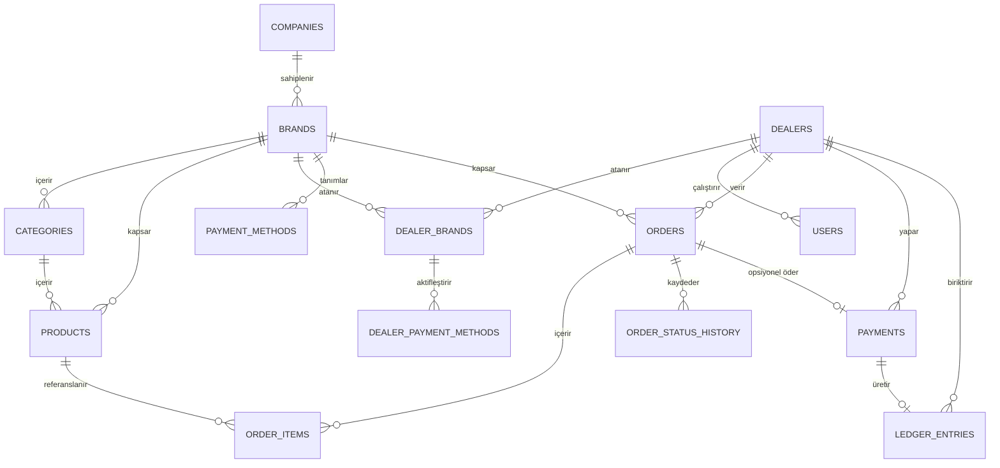
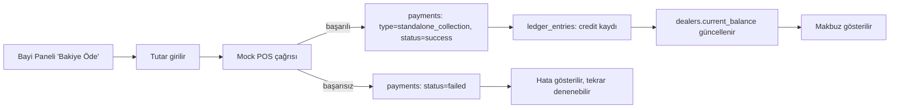

# HarmonyBlend (HB)

Fabrika/genel merkez ile franchise bayiler arasındaki sipariş, ödeme ve cari
tahsilat süreçlerini yöneten çok markalı bayi portalı. Bu doküman mimari,
veri modeli, iş akışı, teknoloji ve ekran planını içerir.

- **Kapsam** — Tunam çatısı altında çoklu alt marka (Musluoğlu, Dilim Börek)
- **Veritabanı** — Neon Postgres, ilk günden sabit
- **Ödeme** — Cari · Nakit/Kapıda Ödeme · Sanal POS (mock)

---

## 1. Fazlandırılmış Yol Haritası

Altı faz; her biri bir öncekinin üstüne çalışır durumda kalacak şekilde
kurgulandı. Sanal POS entegrasyonu bilerek en sona bırakıldı — mock sağlayıcı
arayüzü Faz 3'te kurulduğu için Faz 6 bir "değiştirme" işlemi, yeniden yazma
değil.

### Faz 1 — Temel Altyapı & Veri Modeli Kurulumu

Hedef: Neon DB bağlantısı, ORM ve auth iskeleti — projenin geri kalanının
üstüne oturacağı zemin.

- Neon Postgres projesi + connection string'in ortam değişkenlerine
  tanımlanması (bir kere, kalıcı)
- Drizzle ORM kurulumu ve migration pipeline'ı
- `companies`, `brands`, `users`, `dealers`, `dealer_brands` ilk migration
- Rol bazlı auth iskeleti: firma admini, marka yöneticisi, bayi kullanıcısı

**Çıkış kriteri —** boş fakat çalışan bir admin girişi; veritabanına
yazma/okuma uçtan uca doğrulanmış.

### Faz 2 — Marka, Bayi ve Ürün Yönetimi

Hedef: Admin panelin çekirdek CRUD ekranları; marka bazlı ayrışmanın veri
katmanında kurulması.

- Alt marka CRUD'u ve marka bazlı yetkilendirme
- Bayi CRUD'u + `dealer_brands` ataması
- Kategori/ürün CRUD'u — marka bazlı stok ve ambalaj alanlarıyla
- `payment_methods` tanımları ve bayi/marka bazlı aktivasyon

**Çıkış kriteri —** bir admin yeni bir bayiyi bir markaya bağlayıp, o bayinin
sadece o markanın kataloğunu gördüğünü doğrulayabiliyor.

### Faz 3 — Sipariş & Mock Ödeme Akışı

Hedef: Bayi tarafında sepetten siparişe; ödeme tipine göre dallanan checkout
ve durum makinesi.

- Sepet ve checkout ekranı (marka bazlı katalog)
- Ödeme tipine göre dinamik checkout adımları
- `orders` / `order_items` oluşturma, durum makinesi implementasyonu
- `PaymentProvider` arayüzü + `MockPosProvider`
- `order_status_history` ile denetim izi

**Çıkış kriteri —** üç ödeme tipiyle de uçtan uca sipariş oluşturulabiliyor;
admin panelde durum geçişleri izlenebiliyor.

### Faz 4 — Cari Bakiye & Bağımsız Tahsilat Modülü

Hedef: Siparişten kopuk, serbest tutarlı ödeme ve cari hesap defteri.

- Bayi panelinde "Bakiye Öde" ekranı
- `payments` tablosunda `type = standalone_collection` kaydı
- `ledger_entries` defteri ve bakiye hesaplama
- Admin tarafında cari hesap ekstresi görünümü

**Çıkış kriteri —** bir bayi siparişsiz şekilde mock POS ile ödeme yapıyor ve
cari bakiyesinin anında güncellendiğini görüyor.

### Faz 5 — Raporlama & Analitik

Hedef: Filtrelenebilir, dışa aktarılabilir raporlama motoru.

- Marka / bayi / ürün / tarih aralığı filtreleriyle dinamik tablo ve grafikler
- Excel (.xlsx), CSV ve PDF export
- Büyüyen veri hacmi için özet tablo / materialized view stratejisi

**Çıkış kriteri —** bir firma yetkilisi son üç ayın marka bazlı satışlarını
filtreleyip Excel'e aktarabiliyor.

### Faz 6 — Canlı Sanal POS Entegrasyonu & Sertleştirme

Hedef: Mock sağlayıcının gerçek bir bankayla değiştirilmesi ve production
sertleştirme.

- `PaymentProvider` arayüzünün gerçek sağlayıcı (Iyzico/Paytr/banka API)
  implementasyonu
- Webhook/callback doğrulama, 3D Secure akışı
- Yük testi, hata izleme, yedekleme/felaket kurtarma planı

**Çıkış kriteri —** canlı ortamda gerçek bir kartla uçtan uca ödeme
tamamlanabiliyor; mock sağlayıcı hiçbir çağıran kodu değiştirmeden devre dışı
kalabiliyor.

---

## 2. Veri Modeli

PostgreSQL / Neon DB uyumlu. Marka bazlı ayrışma her katalog ve stok
tablosunda `brand_id` ile; sipariş içi/dışı ödeme ayrımı
`payments.order_id`'nin null olup olmamasıyla sağlanıyor.



### Kimlik & kiracı yapısı

```
companies
  id            uuid        PK
  name          text
  created_at    timestamptz

brands
  id            uuid        PK
  company_id    uuid        FK -> companies.id
  name          text
  slug          text        UNIQUE
  created_at    timestamptz

dealers
  id                uuid        PK
  company_id        uuid        FK -> companies.id
  name              text
  tax_no            text
  address           text
  current_balance   numeric(14,2)  DEFAULT 0   -- ledger_entries'ten türeyen önbellek
  created_at        timestamptz

dealer_brands
  id            uuid        PK
  dealer_id     uuid        FK -> dealers.id
  brand_id      uuid        FK -> brands.id
  is_active     boolean     DEFAULT true
  UNIQUE(dealer_id, brand_id)

users
  id            uuid        PK
  company_id    uuid        FK -> companies.id
  dealer_id     uuid        FK -> dealers.id   NULL -- null ise firma çalışanı
  email         text        UNIQUE
  role          enum(company_admin, brand_manager, dealer_user)
  password_hash text
  created_at    timestamptz
```

### Katalog

```
categories
  id            uuid        PK
  brand_id      uuid        FK -> brands.id
  parent_id     uuid        FK -> categories.id   NULL -- alt kategori için self-reference
  name          text

products
  id            uuid        PK
  brand_id      uuid        FK -> brands.id
  category_id   uuid        FK -> categories.id
  sku           text
  name          text
  unit          text        -- koli / kg / adet
  unit_price    numeric(12,2)
  is_active     boolean     DEFAULT true
  created_at    timestamptz
```

### Ödeme kuralları

```
payment_methods
  id            uuid        PK
  company_id    uuid        FK -> companies.id
  code          enum(cari, cash_on_delivery, virtual_pos)
  label         text
  config        jsonb       -- limit, gecikme kuralı vb. parametreler

dealer_payment_methods
  id                  uuid    PK
  dealer_id           uuid    FK -> dealers.id
  brand_id            uuid    FK -> brands.id
  payment_method_id   uuid    FK -> payment_methods.id
  is_enabled          boolean DEFAULT true
  UNIQUE(dealer_id, brand_id, payment_method_id)
```

### Sipariş

```
orders
  id                  uuid        PK
  dealer_id           uuid        FK -> dealers.id
  brand_id            uuid        FK -> brands.id
  payment_method_id   uuid        FK -> payment_methods.id
  status              text        -- bkz. Bölüm 3, durum makinesi
  total_amount        numeric(14,2)
  created_by          uuid        FK -> users.id
  created_at          timestamptz
  updated_at          timestamptz

order_items
  id            uuid        PK
  order_id      uuid        FK -> orders.id
  product_id    uuid        FK -> products.id
  quantity      numeric(10,2)
  unit_price    numeric(12,2)
  line_total    numeric(14,2)

order_status_history
  id            uuid        PK
  order_id      uuid        FK -> orders.id
  from_status   text
  to_status     text
  changed_by    uuid        FK -> users.id   NULL -- sistem tetiklemesiyse boş
  note          text
  created_at    timestamptz
```

### Ödeme & cari hareket

```
payments
  id              uuid        PK
  dealer_id       uuid        FK -> dealers.id
  order_id        uuid        FK -> orders.id   NULL -- null ise sipariş dışı bağımsız tahsilat
  type            enum(order_payment, standalone_collection)
  provider        enum(mock, iyzico, paytr)
  amount          numeric(14,2)
  status          enum(pending, success, failed, refunded)
  provider_ref    text        NULL -- banka/POS işlem referansı
  created_at      timestamptz

ledger_entries
  id              uuid        PK
  dealer_id       uuid        FK -> dealers.id
  direction       enum(debit, credit)   -- borç / alacak
  amount          numeric(14,2)
  source_type     enum(order, payment, manual_adjustment)
  source_id       uuid        NULL -- kaynak kayda referans
  balance_after   numeric(14,2)
  created_at      timestamptz
```

> **Neden ayrı bir ledger_entries?** `dealers.current_balance` sık okunan bir
> önbellektir; gerçek kaynak `ledger_entries`'teki hareket geçmişidir. Bu
> ayrım, cari ekstresinin her zaman yeniden hesaplanabilir/denetlenebilir
> olmasını sağlar.

---

## 3. Sipariş & Tahsilat Akış Algoritması

Sipariş durum makinesi, checkout anında seçilen `payment_method`'a göre üç
ayrı yola dallanır. Her geçiş `order_status_history`'ye yazılır.

**Cari (Açık Hesap):** draft → submitted → approved → preparing → shipped →
delivered → closed. (approved öncesi: cancelled / rejected)

**Nakit / Kapıda Ödeme:** draft → submitted → approved → preparing → shipped
→ awaiting_cash_collection → delivered_paid → closed. (tahsil edilemezse:
ledger'a borç düşülür, "Bakiye Öde" ile kapanır)

**Sanal POS (Mock):** draft → awaiting_payment → paid → approved → preparing
→ shipped → delivered → closed. (POS başarısız: payment_failed → retry /
cancelled)

> **Kural:** Sanal POS akışında sipariş, ödeme `success` dönmeden `approved`
> durumuna geçemez — hazırlık süreci ödemeyle kilitlenir. Cari akışında ödeme
> adımı yoktur; onay doğrudan hazırlık sürecini tetikler.

### Sipariş Dışı Bağımsız Sanal POS Tahsilatı

Bayi, herhangi bir siparişe bağlı olmadan cari bakiyesini kapatmak için
serbest tutar girip mock POS üzerinden öder. Bu akış `orders` tablosuna hiç
dokunmaz.



---

## 4. Önerilen Teknoloji Yığını

Tek ekip / hızlı iterasyon senaryosuna göre optimize edildi: Next.js tabanlı
tek bir monolit, Neon'un serverless doğasına uygun bir ORM.

| Katman | Öneri | Gerekçe |
|---|---|---|
| Frontend / Backend | Next.js 15 (App Router) + TypeScript | Server Actions ile admin/bayi panellerini tek repo'da tutar; Vercel + Neon entegrasyonu native. |
| UI Katmanı | Tailwind CSS + shadcn/ui | Kurumsal tablo/form yoğun ekranlar için hızlı, erişilebilir bileşen tabanı. |
| Veri getirme | TanStack Query + Server Actions | Sipariş/rapor ekranlarında optimistic update ve cache invalidation. |
| ORM | Drizzle ORM | Neon'un serverless sürücüsüyle edge-uyumlu, SQL'e yakın; Prisma'ya göre soğuk başlangıç maliyeti düşük. |
| Veritabanı | Neon Postgres | Zorunlu kısıt. Branch özelliği dev/staging izolasyonu için ayrıca faydalı. |
| Kimlik doğrulama | Auth.js (credentials) + rol bazlı middleware | Firma admini / marka yöneticisi / bayi kullanıcısı ayrımı route seviyesinde uygulanır. |
| Önbellekleme | Upstash Redis | Serverless uyumlu; rapor sorgu sonuçları ve oturum verisi için. |
| Excel / CSV export | exceljs, csv-stringify | Sunucu tarafında akış (streaming) ile büyük raporlarda bellek dostu üretim. |
| PDF export | @react-pdf/renderer | React bileşenleriyle rapor şablonu; ayrı bir headless tarayıcıya ihtiyaç duymaz. |
| Grafikler | Recharts | Raporlama ekranındaki filtrelenebilir grafikler için hafif, React-native API. |
| Ödeme soyutlaması | `PaymentProvider` arayüzü + `MockPosProvider` | Faz 6'da gerçek sağlayıcı (Iyzico/Paytr) sadece yeni bir implementasyon eklenerek takılır. |
| Hosting | Vercel | Preview deployment'lar + Neon branch'leriyle PR bazlı izole test ortamları. |
| İzleme | Sentry | Ödeme ve sipariş durum geçişleri gibi kritik akışlarda hata görünürlüğü. |
| Test | Vitest + Playwright | Playwright özellikle üç farklı checkout akışının regresyona karşı korunması için önemli. |

---

## 5. B2B Kullanıcı Arayüzü / Ekran Mimarisi

İki ayrı panel, ortak bir bileşen kütüphanesi üzerine kurulu; navigasyon
role göre farklılaşır.

### Yönetici Paneli

| Ekran | Amaç | Öne çıkan bileşenler |
|---|---|---|
| Genel Bakış | Günlük/haftalık sipariş ve tahsilat özeti | KPI kartları, marka bazlı mini grafikler |
| Marka Yönetimi | Alt marka tanımı ve ayarları | Marka CRUD formu, logo/ayar alanları |
| Bayi Yönetimi | Bayi tanımı, marka ataması, ödeme yöntemi kuralları | Bayi profil formu, marka atama matrisi, cari limit alanı |
| Ürün & Kategori | Marka bazlı katalog yönetimi | Kategori ağacı, ürün tablosu, toplu fiyat güncelleme |
| Sipariş Yönetimi | Gelen siparişleri onaylama, durum güncelleme | Durum makinesi zaman çizelgesi, filtrelenebilir sipariş tablosu |
| Cari Hesap Ekstresi | Bayi bazlı borç/alacak hareket dökümü | Ledger tablosu, bakiye grafiği |
| Raporlama | Marka/bayi/ürün/tarih filtreli analiz | Filtre çubuğu, dinamik tablo + grafik, Excel/CSV/PDF export butonları |

### Bayi Paneli

| Ekran | Amaç | Öne çıkan bileşenler |
|---|---|---|
| Ana Sayfa | Bakiye özeti, son siparişlerin durumu | Bakiye kartı, son 5 sipariş listesi |
| Ürün Kataloğu & Sepet | Erişimi olan marka(lar)ın ürünlerini sepete ekleme | Marka sekmeleri, ürün kartı, sepet çekmecesi |
| Checkout | Ödeme tipine göre dallanan sipariş tamamlama | Dinamik adım göstergesi, ödeme tipi kartı, mock POS formu (yalnızca Sanal POS seçiliyse) |
| Siparişlerim | Geçmiş ve aktif siparişlerin takibi | Durum rozeti, zaman çizelgesi görünümü |
| Cari Bakiye & Serbest Ödeme | Sipariş dışı borç kapatma | Bakiye özeti, serbest tutar girişi, makbuz geçmişi |

> **Paylaşılan bileşenler:** rol bazlı kenar çubuğu, durum rozeti (renk =
> durum ailesine göre; ödeme tipi ayrı bir etiket olarak gösterilir), boş
> durum illüstrasyonları, tutar alanlarında sağa hizalı sayısal kolonlar.
